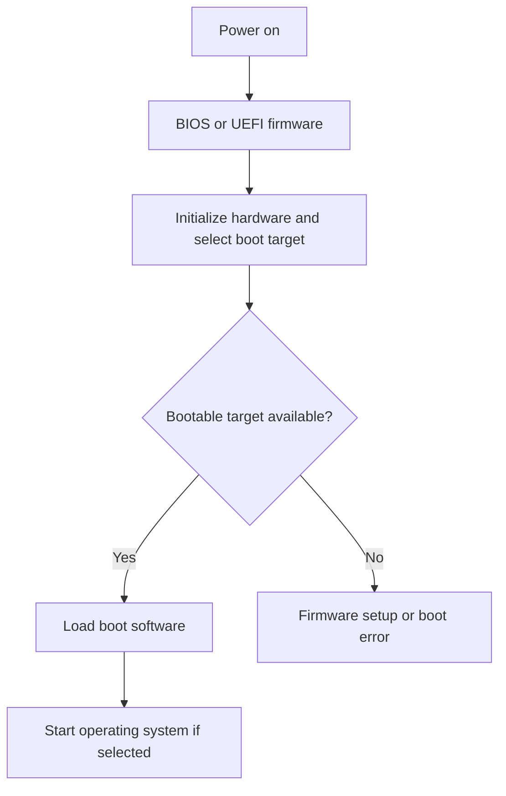
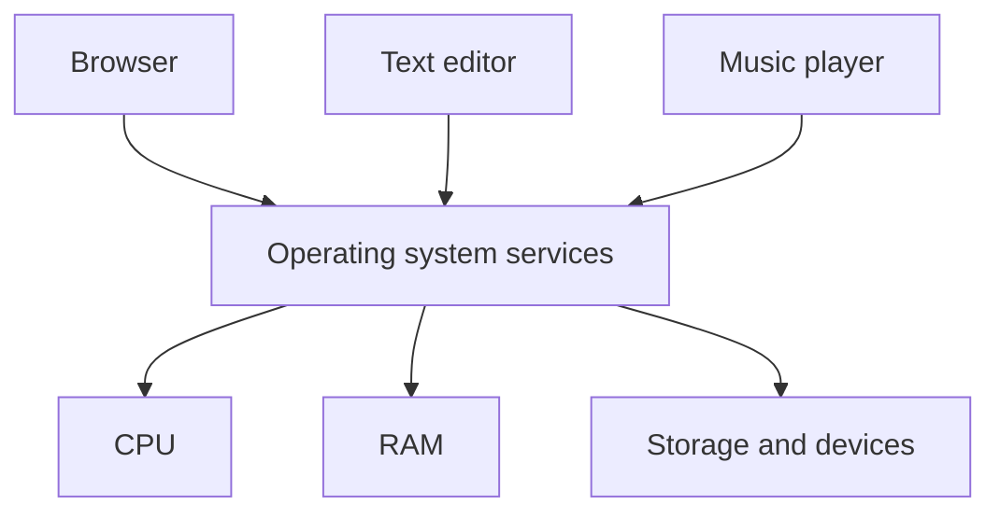

# LAB-001 — Operating System Fundamentals

**Date:** 24 November 2026  
**Track:** Linux — Infrastructure Labs  
**Status:** Initial learning complete; retention pending

## 1. Learning objectives

- Distinguish hardware, firmware and an operating system (OS).
- Explain why general-purpose computers use operating systems.
- Understand volatile and non-volatile memory, allocation and protection.
- Explain CPU scheduling, context switching, concurrency and parallelism.
- Recognise that software can execute without a general-purpose OS.

## 2. Hardware, firmware and the OS

Hardware consists of physical components: the CPU executes instructions, RAM holds working instructions and data, and storage preserves files and programs. Firmware is software that provides low-level control of hardware. On a typical PC, BIOS or UEFI firmware resides in non-volatile flash memory on the motherboard. It initializes hardware, performs startup checks and locates a bootable target. UEFI settings are typically stored in non-volatile variable storage.

This is a simplified PC startup sequence; boot mechanisms vary. A computer with no installed OS can still execute firmware, inspect some hardware and potentially boot from external media or a network. Windows Safe Mode, however, is a restricted mode of Windows, not a firmware feature.

### Bare-metal execution

A CPU needs executable instructions, not necessarily an operating system. A dedicated program can interact directly with hardware: for instance, a microcontroller may periodically read a temperature sensor and update a display without an OS. Such a program must provide the hardware control and resource coordination it needs itself. Ordinary desktop applications generally depend on OS services and cannot simply run unchanged on bare hardware.

## 3. Why an operating system exists

An operating system is system software that manages hardware resources and provides abstractions and services for applications. Its responsibilities include CPU scheduling, memory management, protection, device access, storage and networking. It enables applications to share resources in a controlled manner.

A graphical user interface is optional. A Linux server can operate without a desktop, using command-line tools, remote administration and background services. The diagram is conceptual: applications execute CPU instructions directly in user mode for ordinary computation, and request privileged services through controlled interfaces.

## 4. Memory fundamentals

| Concept | Meaning | Example |
|---|---|---|
| Volatile memory | Ordinary working memory loses its contents without power | DRAM, ordinary CPU registers and cache |
| Non-volatile memory/storage | Retains stored information without continuous power | SSD, motherboard flash, USB flash drive |
| Memory allocation | Assigns and manages memory for programs | A text editor obtains memory for an open document |
| Memory protection | Restricts access to memory according to permissions | A browser cannot overwrite another process's private memory |

A document successfully persisted to an SSD survives power loss under normal conditions; edits held exclusively in ordinary RAM do not, assuming no autosave, recovery or backup power. Saving must actually reach durable storage; merely buffering a write does not guarantee persistence.

Memory allocation and protection are different. Allocation answers where and how much memory a process can use. Protection answers which memory it is permitted to access. Modern general-purpose operating systems use hardware mechanisms, typically including a memory management unit (MMU), to help enforce process isolation. Deliberately shared memory is possible when authorized.

## 5. CPU scheduling and context switching

CPU scheduling determines which runnable task receives CPU execution time. A process does not normally need to finish before another process can run. The operating system can preempt a task, save its execution context (such as registers and instruction pointer), restore another task's context, and resume the original later. This is context switching. A switch can also occur when a task blocks waiting for I/O.

### Concurrency versus parallelism

- **Concurrency:** Multiple tasks make progress over overlapping periods of time. They may take turns or execute in parallel.
- **Parallelism:** Multiple tasks execute simultaneously on separate execution resources.

Illustrative schedule for two cores, each supporting one hardware thread:

| Time slice | Core 1 | Core 2 |
|---|---|---|
| 1 | P1 | P2 |
| 2 | P3 | P4 |
| 3 | P5 | P6 |
| 4 | P1 | P2 |

All six tasks can make concurrent progress; at most two of these single-threaded CPU-bound tasks can execute simultaneously under the stated assumptions. The table illustrates time sharing, not a guarantee of the actual Linux scheduler's order. Hardware multithreading can change the number of available execution contexts; it does not create extra physical cores.

Analogy: two cashiers serving six customers in turns. A customer does not have to finish all their transactions before another receives service.

## 6. Infrastructure and security relevance

| Concept | Infrastructure application |
|---|---|
| Firmware | Understanding startup failures before the OS loads |
| Durable storage | Understanding what survives a server restart or power failure |
| Memory allocation | Investigating memory pressure and resource exhaustion |
| Memory protection | Protecting process confidentiality and integrity |
| CPU scheduling | Understanding responsiveness under competing workloads |
| Parallelism | Reasoning about CPU capacity and workload execution |
| Optional graphical UI | Administering headless Linux servers |

Memory isolation helps protect confidentiality (preventing unauthorized reads) and integrity (preventing unauthorized writes). It is not a complete security boundary against all attacks; vulnerabilities and privileged access can undermine protection.

## 7. My learning journey

The following records paraphrase my classroom answers and the corrections made during the lesson.

| Initial reasoning | Refined understanding |
|---|---|
| A computer cannot function without an OS; perhaps Safe Mode is available. | Firmware and bare-metal programs can execute without an OS. Windows Safe Mode requires Windows. |
| BIOS supplies startup instructions; its settings survive because memory is non-volatile. | Correct; firmware code and persistent configuration are distinct. |
| Uncoordinated memory allocation creates bottlenecks. | It can also cause unauthorized access, corruption and crashes. |
| A browser overwriting text-editor memory could overwrite my unsaved document. | Correct; memory protection helps prevent this. |
| The OS allocates a range of cores; apparent simultaneous execution is parallel processing. | Scheduling can share one execution thread over time. Concurrency is not the same as parallelism. |
| Concurrency means multi-switching on one core, while parallelism uses multiple cores. | Time sharing is one way to achieve concurrency; concurrency also occurs on multicore systems. |
| The OS manages memory and resources, protects memory and provides a more usable interface. | Correct core responsibilities; a graphical interface is optional. |
| With two cores and six processes, four must wait until the first two terminate. | Tasks can be preempted and resumed. All six can make progress concurrently, with at most two executing simultaneously in this example. |

## 8. Assessment record

| Assessment | Result | Interpretation |
|---|---|---|
| I — Fundamentals | 7/7 (100%) | Correct recognition of foundational concepts |
| II — Applied understanding | 4/7 (57.1%) | Gaps in persistence, parallel execution and bare-metal reasoning |
| III — Guided targeted revision | 2/3 first attempts; 3/3 after retry | All targeted questions eventually answered correctly; CPU scheduling required a guided retry |

### Assessment II: missed questions

1. **Persistence:** Selected firmware only; both firmware in flash and a successfully saved SSD document survive power loss under the stated conditions.
2. **Parallel execution:** Selected eight simultaneous tasks on four single-threaded cores; the correct maximum is four.
3. **Bare-metal execution:** Rejected the possibility of executing a program without a general-purpose OS; such execution is possible.

### Assessment III: correction evidence

- Saved document versus unsaved paragraph: correct on first attempt.
- Six processes on two single-threaded cores: initially assumed other processes must wait for termination; corrected on retry after the time-slice illustration.
- Temperature monitoring without an OS: correctly identified that a dedicated program can interact directly with hardware.

Priority for independent reassessment: CPU scheduling, context switching and concurrency versus parallelism. Also revisit persistence and bare-metal execution. Guided success does not establish long-term retention.

## 9. Spaced repetition plan

| Study day | Date | Planned activity | Status |
|---|---|---|---|
| 1 | 2026-11-24 | Initial lesson and assessments | Complete |
| 2 | 2026-11-25 | Closed-book recall; prioritize scheduling | Pending |
| 4 | 2026-11-27 | New scenario-based questions | Pending |
| 7 | 2026-11-30 | Weekly closed-book assessment | Pending |
| 14 | 2026-12-07 | Retention assessment | Pending |
| 30 | 2026-12-23 | Long-term retention check | Pending |

## 10. Practical work and next steps

This was a conceptual lab. No terminal commands, hardware changes or practical execution tests were performed. Diagrams and examples are illustrative rather than measured results.

Next lab: **LAB-002 — Hardware, Kernel and User Space**. Begin with the distinction between the kernel and the rest of an operating system. Continue revisiting LAB-001 alongside new material.

## References for further reading

- [Operating Systems: Three Easy Pieces](https://pages.cs.wisc.edu/~remzi/OSTEP/) — virtualization, scheduling, memory and concurrency.
- [Linux kernel documentation](https://docs.kernel.org/) — deeper technical reference for later labs.

These are suggested reading resources, not sources consulted during the assessment.
